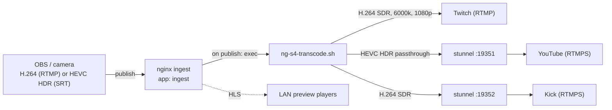
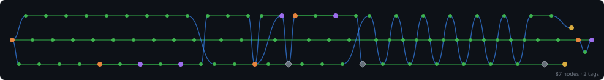

# NG-S4

<!-- Project Shields/Badges -->
<p align="center">
  <a href="https://github.com/XAOSTECH/NG-S4">
    
  </a>
  <a href="https://github.com/XAOSTECH/NG-S4/releases">
    
  </a>
  <a href="https://github.com/XAOSTECH/NG-S4/blob/main/LICENSE">
    
  </a>
</p>

<p align="center">
  <a href="https://github.com/XAOSTECH/NG-S4/actions">
    
  </a>
  <a href="https://github.com/XAOSTECH/NG-S4/issues">
    
  </a>
  <a href="https://github.com/XAOSTECH/NG-S4/pulls">
    
  </a>
  <a href="https://github.com/XAOSTECH/NG-S4/stargazers">
    
  </a>
  <a href="https://github.com/XAOSTECH/NG-S4/network/members">
    
  </a>
</p>

<p align="center">
  
  
  
  
</p>

<!-- Optional: Stability/Maturity Badge -->
<p align="center">
  
  
</p>

---

<p align="center">
  <b>NG-S4: an Nginx + Stunnel4 RTMP/RTMPS restream server with HLS preview and hardware-accelerated, HDR-aware multi-format transcoding for Linux and WSL2. Broadcast one source to many platforms at once.</b>
</p>

---

# Nginx + Stunnel4 RTMP restreaming server

NG-S4 turns a single Linux box into a multi-platform restream server built entirely from native, apt-installable components: nginx with the RTMP module, stunnel4 for RTMPS, and ffmpeg for encoding.
Publish one master feed and NG-S4 fans it out to Twitch, YouTube, Kick and any other RTMP/RTMPS target, re-encoding each output independently so every platform receives a stream that suits its limits.

The headline capability is per-target transcoding.
You can send 4K60 HDR (HEVC, Main10) to YouTube while simultaneously delivering a tone-mapped SDR H.264 copy to Twitch that respects its 6000 kbps ceiling and lower frame rate, all from the same ingest.

The transcode engine detects the best encoder for the host at runtime, so the same project runs on an Ubuntu 26.04 workstation with an NVIDIA GPU (NVENC), a Raspberry Pi on Ubuntu 24.04 (V4L2 M2M), or any machine using software x264/x265.

## Core features

*   **One ingest, many outputs:** publish once over RTMP (or SRT for HDR) and NG-S4 pushes a tailored encode to every enabled platform.
*   **Per-platform profiles:** resolution, frame rate, codec, bitrate ceiling, buffer and HDR/SDR are configured independently per target in `master.env`.
*   **HDR aware:** HDR sources pass through to HDR targets (HEVC Main10, BT.2020/PQ) and are tone-mapped to SDR (BT.709) for platforms that do not support HDR.
*   **Hardware accelerated:** NVENC on NVIDIA hosts, V4L2 M2M on Raspberry Pi, automatic software fallback, all selected at runtime.
*   **RTMPS via stunnel4:** platforms that require TLS (YouTube, Kick) are reached through local stunnel tunnels.
*   **HLS preview:** the ingest is also published as low-latency HLS for monitoring on the LAN.
*   **LAN friendly:** the allowed publish/play network is a single configuration value.
*   **Host agnostic:** scripts derive their own paths and write no home directory into any config.
*   **Native and lean:** bash, nginx, stunnel and ffmpeg only, installed from apt. No Python, no third-party runtimes.

## Architecture



## Directory structure

```
NG-S4/
├── example.env/            # Templates: copy into real.env and edit
│   ├── master.env          # All configuration, including transcode profiles
│   ├── nginx.conf          # Ingest + HLS (tokens substituted at setup)
│   ├── stunnel.conf        # RTMPS tunnels for YouTube/Kick
│   └── cleaned_up/         # Comment-free copies of the above
├── real.env/               # Your live configuration (git ignored)
├── UNIX-Scripts/
│   ├── setup-restream.sh          # Install and configure everything
│   ├── ng-s4-transcode.sh         # The fan-out transcode engine
│   ├── ng-s4-doctor.sh            # Capability and configuration check
│   ├── manage-services.sh         # Start/stop/status for nginx + stunnel4
│   ├── generate-stunnel-cert.sh   # Self signed certificate for stunnel
│   ├── reset-restream.sh          # Uninstall and clean up
│   └── stream-gphoto2-webcam.sh   # Stream a DSLR/mirrorless camera to ingest
├── WSL2-Setup/             # Optional PowerShell helpers for Windows/WSL2
└── docs/README.md          # This file
```

## Requirements

*   A Linux host with `sudo`. Tested targets:
    *   Ubuntu 26.04 workstation with an NVIDIA GPU (NVENC encode).
    *   Raspberry Pi on Ubuntu 24.04 (V4L2 M2M encode).
*   Packages installed automatically by the setup script from apt: `nginx`, `libnginx-mod-rtmp`, `stunnel4`, `ffmpeg`, `gphoto2`.
*   For NVENC you also need the NVIDIA driver present (`nvidia-smi` working). NG-S4 does not install GPU drivers; it detects and uses them.
*   For HDR ingest you need an ffmpeg with `libx265` and `libzimg` (the `zscale` filter). Ubuntu's ffmpeg ships both. Run the doctor to confirm.

## Quick start (standalone Linux)

```bash
git clone <repository_url> && cd NG-S4

# 1. Create your live configuration from the templates.
mkdir -p real.env
cp example.env/master.env real.env/master.env
cp example.env/nginx.conf real.env/nginx.conf
cp example.env/stunnel.conf real.env/stunnel.conf

# 2. Edit real.env/master.env: set LAN_CIDR, your stream keys and the per
#    platform profiles (see below). For Kick, also set the ingest host in
#    real.env/stunnel.conf.
nano real.env/master.env

# 3. Install and start everything.
sudo bash UNIX-Scripts/setup-restream.sh

# 4. Verify the host can encode what you intend to send.
bash UNIX-Scripts/ng-s4-doctor.sh
```

Then point OBS (or any encoder) at the ingest:

*   **Server:** `rtmp://<this-host>:1935/ingest`
*   **Stream key:** any name, for example `live`

Monitor locally while you stream:

*   **HLS preview:** `http://<this-host>:8080/hls/ingest/live/index.m3u8`
*   **RTMP stats:** `http://<this-host>:8080/stat`
*   **Health:** `http://<this-host>:8080/healthz`

## Configuration (`real.env/master.env`)

All configuration lives in one file. The most important core values:

| Variable | Purpose |
| --- | --- |
| `LAN_CIDR` | Network allowed to publish and play, for example `192.168.0.0/24`. |
| `NGINX_HTTP_PORT` | Port for HLS, stats and health (default `8080`). |
| `HLS_BASE_DIR` | Where HLS segments are written (default `/mnt/hls`). |
| `INGEST_APP` | Name of the nginx RTMP application (default `ingest`). |
| `ENCODER_BACKEND` | `auto`, `nvenc`, `v4l2m2m` or `software`. |
| `SOURCE_HDR` | `auto` (probe the stream), `hdr`, or `sdr`. |
| `LOG_DIR` | Setup, reset and transcode logs (default `/var/log/ng-s4`). |

The nginx port, LAN range and HLS path are tokens in `nginx.conf`; the setup script renders them from `master.env`, so you edit values in one place only.

## Transcoding and restream profiles

`master.env` defines a space-separated `TARGETS` list (for example `TW YT KI`) and one block of variables per target.
Each block is independent, so every platform gets exactly the format it needs.

| Variable (per target) | Meaning |
| --- | --- |
| `<ID>_ENABLE` | `1` to stream to this target, `0` to skip. |
| `<ID>_URL` / `<ID>_KEY` | Ingest base URL (no key) and the stream key. |
| `<ID>_VCODEC` | `h264`, `hevc`, or `copy` (pass the source through untouched). |
| `<ID>_HDR` | `hdr` keeps the HDR colour space; `sdr` tone-maps an HDR source down. |
| `<ID>_SCALE` | Output size such as `1920:-2` (`-2` keeps the aspect ratio); empty keeps the source. |
| `<ID>_FPS` | Output frame rate; empty keeps the source. |
| `<ID>_VBITRATE` / `<ID>_MAXRATE` / `<ID>_BUFSIZE` | Rate control, used to respect platform ceilings. |
| `<ID>_ABITRATE` | Audio bitrate (AAC, 48 kHz stereo). |

### Worked example: 4K60 HDR to YouTube, downmixed SDR to Twitch

This is the shipped default. YouTube receives the HDR master, Twitch receives a tone-mapped SDR copy within its limits:

```bash
# Twitch: direct RTMP, tone-mapped to SDR, 1080p30, hard 6000 kbps ceiling.
TW_ENABLE=1 TW_VCODEC=h264 TW_HDR=sdr TW_SCALE="1920:-2" TW_FPS=30
TW_VBITRATE=6000k TW_MAXRATE=6000k TW_BUFSIZE=9000k

# YouTube: RTMPS via stunnel, HDR preserved as HEVC Main10 at source resolution/fps.
YT_ENABLE=1 YT_VCODEC=hevc YT_HDR=hdr YT_SCALE="" YT_FPS=""
YT_VBITRATE=45000k YT_MAXRATE=51000k YT_BUFSIZE=90000k
```

With an NVIDIA host this runs the YouTube path fully on the GPU (`hevc_nvenc`, Main10, BT.2020/PQ) and tone-maps the Twitch path on decode, so a single publish produces both outputs.
Set `YT_VCODEC=copy` to pass an already-encoded HEVC HDR master straight through with no re-encode, for the lowest possible latency and load.

## Cross-platform notes

The engine chooses an encoder backend at runtime (override with `ENCODER_BACKEND`):

*   **NVIDIA (Ubuntu 26.04 host):** `h264_nvenc` / `hevc_nvenc`, with HDR HEVC passthrough kept entirely on the GPU. The setup script adds the nginx user to the `video` and `render` groups so the worker can reach `/dev/nvidia*`.
*   **Raspberry Pi (Ubuntu 24.04):** `h264_v4l2m2m`. Because the Pi encoder has no 10-bit HDR path, any HDR target automatically falls back to software `libx265` for that output. Keep Pi workloads to 1080p SDR for real-time performance.
*   **Software fallback:** `libx264` / `libx265` on any host.

Run `UNIX-Scripts/ng-s4-doctor.sh` on each machine to print the detected backend, available encoders, HDR tone-mapping filters and the status of every configured target.

## HDR ingest note

The nginx RTMP module carries H.264/AAC only, so a true HDR (HEVC 10-bit) master cannot be ingested over RTMP.
For HDR, ingest over SRT instead, which carries HEVC and HDR natively, and let the engine read it directly:

```bash
# In master.env:
export INGEST_INPUT="srt://0.0.0.0:9000?mode=listener&latency=200"

# Run the engine as the ingest (for example under systemd, or manually):
sudo -u www-data /usr/local/bin/ng-s4-transcode.sh hdr
```

OBS can output SRT (MPEG-TS) with an HEVC encoder for this path.
For SDR H.264 sources, the default RTMP ingest with the nginx `exec` trigger needs no extra steps.

## LAN access and firewall

*   Set `LAN_CIDR` to your subnet so other machines may publish and play.
*   Open the required ports on the host firewall (for example with `ufw`): `1935/tcp` for RTMP and `NGINX_HTTP_PORT` (default `8080`) for HLS, stats and health.
*   SRT ingest (if used) listens on its own UDP port, for example `9000/udp`.

## Managing services

```bash
sudo bash UNIX-Scripts/manage-services.sh status all
sudo bash UNIX-Scripts/manage-services.sh restart nginx
sudo bash UNIX-Scripts/manage-services.sh stop stunnel4
```

Transcode logs are written per stream and per target under `LOG_DIR` (default `/var/log/ng-s4`), for example `transcode-live.log` and `transcode-live-YT.log`.

## Camera (gphoto2) streaming

`UNIX-Scripts/stream-gphoto2-webcam.sh` streams a gphoto2-compatible camera straight into the ingest, where it is transcoded and fanned out like any other source.
It selects the best available H.264 encoder (NVENC, V4L2 M2M, or x264) automatically.

```bash
# Uses rtmp://127.0.0.1:1935/ingest/camera by default.
sudo bash UNIX-Scripts/stream-gphoto2-webcam.sh
# Or specify a different ingest target:
sudo bash UNIX-Scripts/stream-gphoto2-webcam.sh rtmp://127.0.0.1:1935/ingest/cam1
```

Bitrate, frame rate and audio settings can be overridden with environment variables (`VIDEO_BITRATE`, `VIDEO_FRAMERATE`, `AUDIO_BITRATE`, and so on).

## Stunnel and RTMPS

Targets whose `*_URL` points at `127.0.0.1:<port>` are delivered over TLS by stunnel.
The accept ports in `real.env/stunnel.conf` must match `YT_STUNNEL_PORT` / `KI_STUNNEL_PORT` in `master.env` (defaults `19351` and `19352`).
Set the correct Kick ingest host in `stunnel.conf`; the certificate is generated by the setup script (regenerate manually with `sudo bash UNIX-Scripts/generate-stunnel-cert.sh`).

## Resetting

```bash
sudo bash UNIX-Scripts/reset-restream.sh
```

This stops the services and any running transcodes, purges nginx and stunnel4, and removes the installed engine (`/usr/local/bin/ng-s4-transcode.sh`), the pointer file (`/etc/default/ng-s4`) and the HLS directory. Logs under `LOG_DIR` are kept.

## WSL2 (Windows)

The `WSL2-Setup/` PowerShell scripts remain available to install a distribution, run the Linux setup inside it, and manage Windows Firewall rules for reaching the ingest from the LAN.
Hardware encode inside WSL2 is limited, so NVENC/HDR workloads are best run on a native Linux host.
See the scripts in `WSL2-Setup/` for `Install-RestreamWSL.ps1`, `WSL2-mgr.ps1` (backup/restore) and `WSL2-UFW.ps1` (firewall).

## Troubleshooting

*   **Capability check:** run `UNIX-Scripts/ng-s4-doctor.sh` first; it flags missing encoders, filters or keys.
*   **A target does not start:** check its `*_ENABLE`, `*_URL` and `*_KEY`. Placeholder keys are skipped on purpose. See `LOG_DIR/transcode-<name>-<ID>.log`.
*   **nginx:** logs in `/var/log/nginx/error.log`; validate config with `sudo nginx -t`.
*   **stunnel4:** logs at the `output` path in `/etc/stunnel/stunnel.conf`.
*   **NVENC permission errors:** confirm the nginx user is in the `video`/`render` groups (the setup script adds it) and restart nginx.
*   **Firewall:** ensure `1935/tcp` and the HTTP port are open for LAN sources.

## Licence

NG-S4 is licensed under the GNU General Public Licence v3 or later (see `LICENSE`).
A commercial or separate licence is available on request from the owner.

<!-- TREE-VIZ-START -->



[Full SVG](../.github/static/tree-viz/git-tree.svg) · [Interactive version](../.github/static/tree-viz/git-tree.html) · [View data](../.github/static/tree-viz/git-tree-data.json)

<!-- TREE-VIZ-END -->
